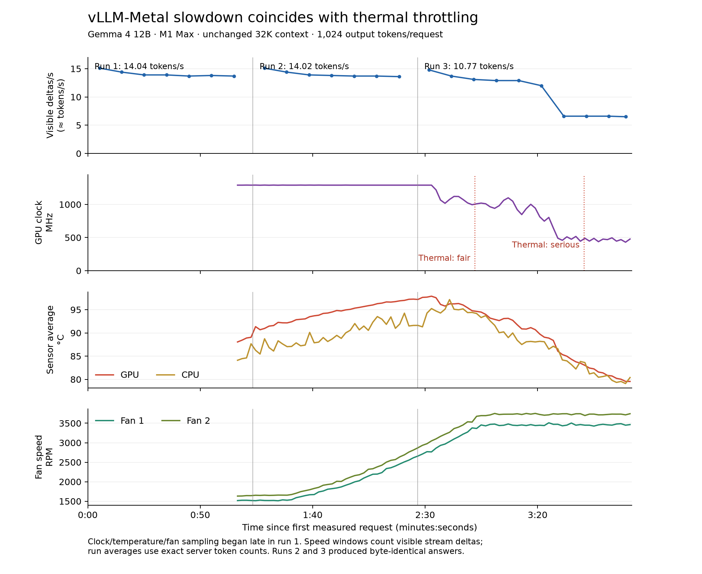

# Local vLLM slowdown: thermal throttling reproduced

The repeated loss of generation speed was reproduced while measuring GPU clocks,
temperatures, fan speeds, thermal pressure, memory and swap activity. The GPU
throttled during the third request. After cooling, unchanged model settings
returned to the original speed.

This establishes the cause of the progressive slowdown in the monitored run.
It strongly supports the same explanation for the user's earlier 13.86 → 10.22
→ 6.05 tokens/s run, which did not have hardware telemetry. It does not establish
why this vLLM setup's unthrottled speed is lower than Ollama's faster results.



## Measurements

Apple M1 Max, 64 GiB unified memory, AC power, low power mode off. Same local
vLLM-Metal model and launcher throughout: 32,768 context, one concurrent request,
thinking off, maximum 1,024 generated tokens, identical prompt and seed.

| Measurement | Observed result |
|---|---|
| First request | 14.043 tokens/s |
| Second request | 14.020 tokens/s |
| Third request, whole-response average | 10.772 tokens/s |
| Third request, final quarter of visible output | Approximately 6.83 stream deltas/s |
| GPU clock before throttling | 1,291–1,292 MHz |
| GPU clock during final output quarter | Mean 499 MHz; individual readings below 500 MHz |
| Peak GPU sensor average | 97.9°C |
| macOS thermal pressure | Nominal → fair → serious |
| Recheck after cooling, same settings | 14.027 tokens/s |
| Recheck GPU clock during sustained generation | 1,291–1,292 MHz |

The hardware trace begins late in request 1. During request 2, the GPU stayed at
about 1,291 MHz while temperatures rose. During request 3, clock speed fell, then
visible output speed roughly halved. GPU activity remained around 78–81%, so the
GPU was still working; it was working at a lower clock. Temperature subsequently
fell as clocks and power were reduced. That later lower temperature does not
mean the slowdown was unrelated to heat.

Requests 2 and 3 produced byte-identical answers. Both had 83 prompt tokens,
1,024 completion tokens, and the same prefix-cache treatment. They were fresh
conversations. There was no growing conversation history between requests.

Whole-response rates use the benchmark's exact server token counts and decode
duration. The plot and final-quarter estimate use visible stream deltas:
1,023 nonempty deltas for 1,024 completion tokens. They show timing within a
response, not an independently exact tokenizer count.

The first test ended at approximately 18:52 UTC. The recheck started the server
at 18:53:45 UTC and generated at 18:54:24 UTC, after about 2 minutes 25 seconds
without decoding. Its initial GPU temperature was about 59°C, and its already
elevated fans stayed near 3,450/3,730 RPM. The recovery is a short-run observation,
not a claim that a long agent session will sustain 14 tokens/s indefinitely.

## Other hypotheses checked

- **Active swap thrashing:** not observed. Across the three measured requests,
  swap-ins totaled 33.78 MiB and swap-outs were zero. The approximately 15 GiB
  of already allocated swap alone was misleading; cumulative activity mattered.
- **Progressive model memory growth:** engine RSS stayed around 9,314 MiB after
  the first request. System-wide GPU allocation stayed around 27.66–27.75 GiB.
  macOS memory pressure stayed at level 1 (normal). This short run provides no
  evidence of an accumulating leak causing the slowdown.
- **Larger context setting:** the configured limit stayed at 32K throughout;
  it cannot explain the progressive change between these identical short
  requests. The earlier Ollama 8K-versus-32K comparison remains confounded by
  machine temperature and run order. A separate context-size effect is not ruled out.
- **Benchmark accounting:** server decode timings and client streaming estimates
  agreed. The saved stream shows continuous slower output, not a single network stall.
- **CPU-only inference:** the server used MLX/Metal, and GPU utilization was high.

Macs Fan Control was running. Fans rose from roughly 1,500/1,650 RPM to
3,450/3,730 RPM during the baseline. Its preferences contained no saved custom
presets, but this does not establish the effective live fan policy. No fan
settings, power settings, other applications, model weights, runtime packages,
or upstream vLLM-Metal code were changed. All inference was local, and both
benchmark-owned servers and sensor processes were stopped afterward.

## What to do next

Before comparing engines or context sizes again, establish repeatable cooling:
use the same physical placement, fan policy and starting temperature, and record
hardware telemetry for both engines. Inspect the current fan policy in Macs Fan
Control; a deliberately controlled fan-speed experiment can test whether cooling
prevents the sustained slowdown. This investigation did not change that policy.
The app documents its [Automatic and Full blast presets](https://crystalidea.com/macs-fan-control/fan-presets).

Measure cold/short-run performance separately from sustained performance. Avoid
interpreting a median across a thermally degrading sequence as a stable engine
throughput figure. Record the context size actually occupied as well as its limit.

The unthrottled vLLM result remains about 14 tokens/s. Comparing that with Ollama
still includes different quantized artifacts (MLX affine mixed precision versus
NVFP4) and backend settings. Resolving that baseline gap is a separate experiment;
thermal throttling is not a sufficient explanation for all engine differences.

## Reproduction and artifacts

The new wrapper records VM counters, GPU utilization/allocation, process CPU/RSS,
macOS thermal pressure and power mode. With `--macmon`, it also records hardware
clocks, temperatures, fans and power. It keeps the system awake only while its
child command runs and cleans up its own sensor process.

```sh
.venv/bin/python scripts/monitor_local_inference.py \
  --label vllm --macmon downloads/tools/macmon-v0.9.0 -- \
  .venv/bin/python scripts/benchmark_12b.py vllm --start-server
```

The read-only sensor tool is [macmon](https://github.com/vladkens/macmon), release
v0.9.0. Its release archive was verified against the GitHub asset SHA-256:
`539d8a39dc4c3823d68410de1c270289790826d983b005b91b2a4441008108bb`.
The executable is workspace-local, not globally installed. Without macmon, the
wrapper still records the other counters. Neither path requires sudo.

The aggregate chart above is included in Git. Raw measurements and run artifacts
remain local under the ignored `results/` directory:

- Baseline benchmark: `results/20261014T184718782367Z-speed-vllm/summary.json`
- Baseline telemetry: `results/20261014T184718619755Z-monitor-vllm-baseline/`
- Recovery benchmark: `results/20261014T185345584797Z-speed-vllm/summary.json`
- Recovery telemetry: `results/20261014T185345412184Z-monitor-vllm-cooled-recheck/`
- Aligned data and plot code: `results/20261014-slowdown-investigation/`

The plot was made in an isolated temporary matplotlib environment; the project's
Python environments and dependencies were not modified.
